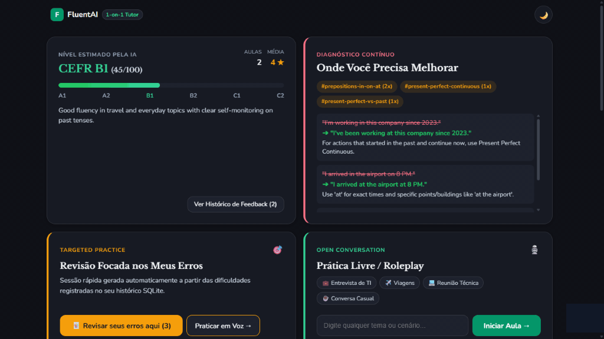

# FluentAI — Adaptive 1-on-1 English Tutor (Gemini Live API)

An interactive, real-time voice English tutoring platform inspired by **Preply**, built on **CLT, PPP, ESA, TBL** methodologies and **Stephen Krashen's** Second Language Acquisition principles (*Comprehensible Input $i+1$* and *Affective Filter*).

<p align="center">
  
</p>

---

## Overview & Key Features

- **Real-Time Voice Tutoring (Gemini Live API)**: Low-latency, full-duplex WebSocket voice coaching with native audio streaming and a collapsible live transcript.
- **Structured CEFR Curriculum (A1 to C2)**: 60 progressive lessons organized by CEFR level (`A1`–`C2`) and module (*Grammar & Foundation*, *Functional Communication*, *Fluency & Pragmatics*), with deep coverage from A2 onward.
- **Open Conversation / Roleplay**: Practice any custom scenario (IT job interviews, travel, technical meetings, casual chat) while keeping the structured tutor persona active.
- **Adaptive Learning Loop & SQLite Persistence**:
  - Every lesson generates a structured post-session report (*What You Did Well*, *"You Said" vs. "Natural Form"* comparisons, 5-minute homework, and focus tags).
  - The AI continuously updates your estimated CEFR level (`0–100`) and injects your recurring weak areas into the next lesson's system prompt.
- **Spaced-Repetition Flashcards (Anki-Style SM-2)**:
  - Automatically generates active-recall flashcards from your real speaking mistakes stored in SQLite, scheduled with the SM-2 algorithm (*Again*, *Hard*, *Good*, *Easy*).

---

## Tech Stack & Project Structure

- **Frontend**: Vanilla JavaScript (Web Components), Vite, Web Audio API, WebSockets, custom CSS Design System (Dark/Light mode).
- **Backend**: Python 3.10+, FastAPI, Uvicorn, `google-genai` SDK, SQLite (`data/learning.db` auto-created at runtime).

```text
.
├── index.html                  # HTML entry point
├── start-app.bat               # One-click Windows launcher
├── requirements.txt            # Python dependencies
├── package.json                # Frontend dependencies (Vite)
├── .env.example                # Environment variable template
├── scripts/
│   ├── dev.ps1                 # Combined Backend + Frontend dev runner (Windows)
│   ├── dev.sh                  # Combined dev runner (Linux/macOS)
│   └── install.sh              # Dependency installer (Linux/macOS)
├── server/
│   ├── main.py                 # FastAPI app, WebSocket proxy & post-lesson evaluation
│   ├── gemini_live.py          # Gemini Live API client (API Key or Vertex AI)
│   ├── db.py                   # SQLite persistence (logs, CEFR profile & SM-2 flashcards)
│   └── ...
└── src/
    ├── style.css               # Design System (Dark/Light themes, semantics, responsive grid)
    ├── data/lessons.json       # CEFR A1–C2 curriculum (60 lessons)
    └── components/             # Web Components (Splash, Dashboard, Classroom, Summary, Flashcards)
```

---

## Prerequisites

- **Node.js** v18+
- **Python** v3.10+
- A **[Google AI Studio](https://aistudio.google.com/)** API key (`GEMINI_API_KEY`) **or** a Google Cloud project with Vertex AI enabled.

---

## Getting Started

### 1. Clone the repository
```bash
git clone https://github.com/adrielrocha20155-lgtm/fluent-ai-tutor.git
cd fluent-ai-tutor
```

### 2. Configure environment variables
Copy `.env.example` to `.env` and add your `GEMINI_API_KEY`:
```bash
# Windows (PowerShell)
Copy-Item .env.example .env

# Linux / macOS
cp .env.example .env
```
Edit `.env` and replace `your_api_key_here` with your Google AI Studio API key.

### 3. Install dependencies

**Windows (PowerShell):**
```powershell
npm install
python -m venv .venv
.\.venv\Scripts\pip install -r requirements.txt
```

**Linux / macOS:**
```bash
./scripts/install.sh
```

### 4. Run the application

**Windows:**
Double-click `start-app.bat` or run:
```powershell
powershell -ExecutionPolicy Bypass -File .\scripts\dev.ps1
```

**Linux / macOS:**
```bash
./scripts/dev.sh
```

Open **`http://localhost:5173/`** in your browser.
